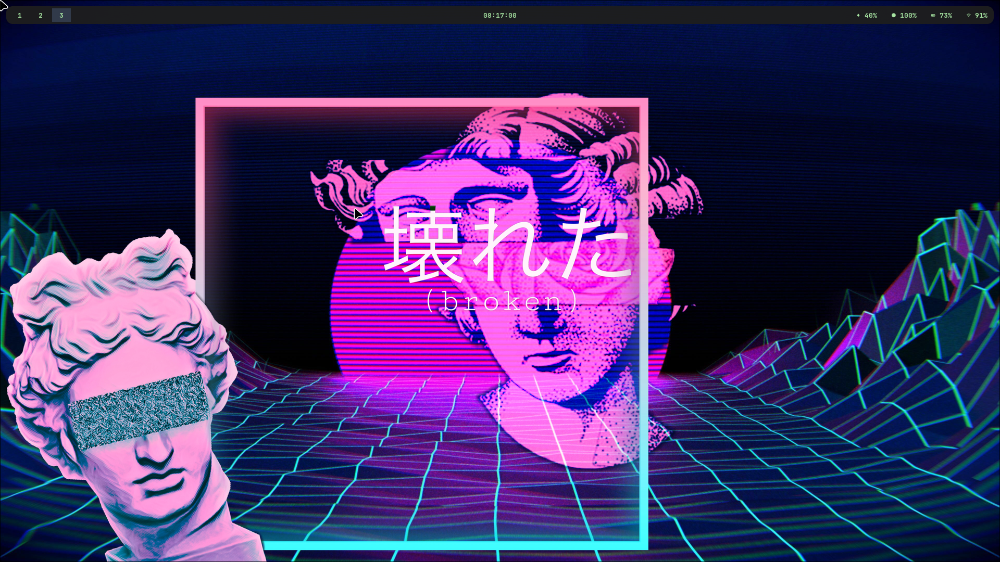
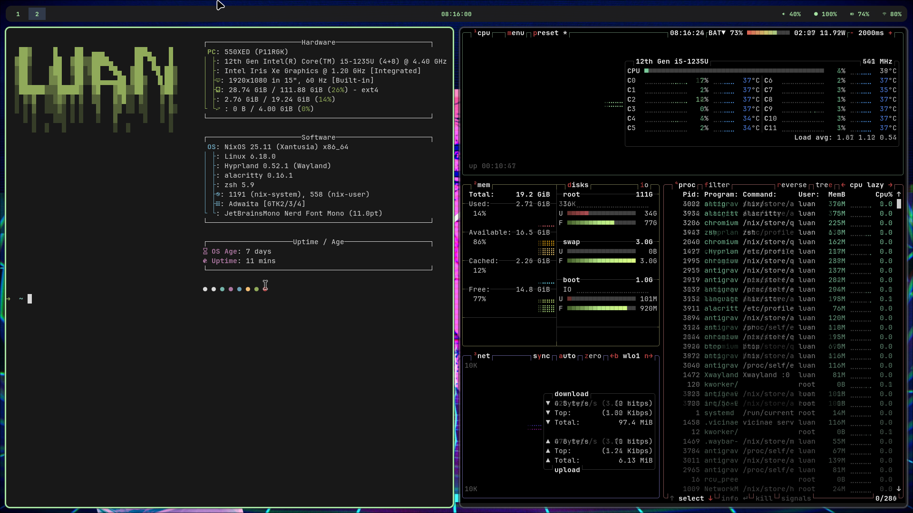
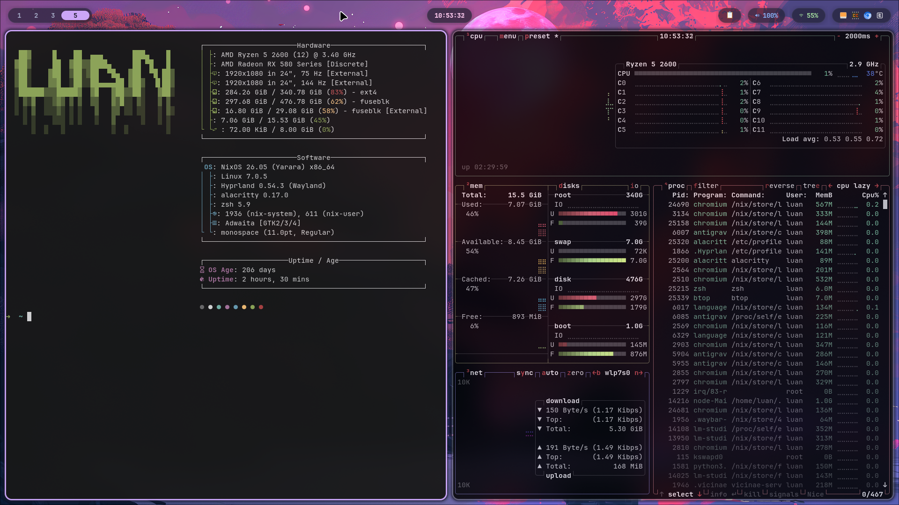
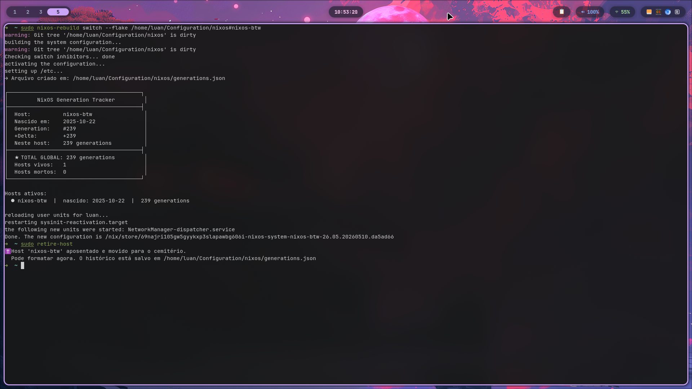
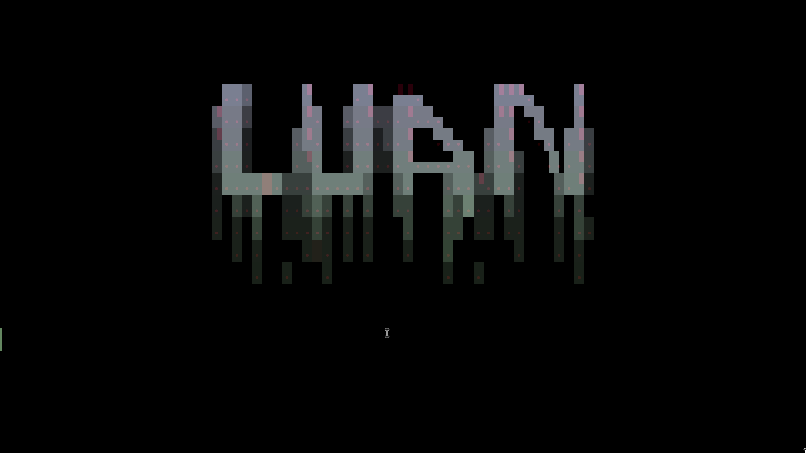

<div align="center">

# ❄️ Declarative NixOS Configuration

A modular, reproducible, and performance-tuned **NixOS** multi-host setup featuring **Hyprland** with static-validated Lua configuration, a reactive **Quickshell (QML)** desktop shell, and a dedicated **local AI & developer workstation stack**.

[](https://nixos.org)
[](https://hyprland.org)
[](https://quickshell.outfoxxed.me)
[](https://github.com/catppuccin/catppuccin)
[](https://github.com/ryantm/agenix)
[](https://github.com/nix-community/home-manager)

</div>

---

## 📑 Table of Contents

- [System Showcase](#-system-showcase)
- [Architecture & Hosts](#-architecture--hosts)
- [Desktop Environment](#-desktop-environment)
  - [Modular Lua Hyprland](#modular-lua-hyprland)
  - [Quickshell QML Desktop Shell](#quickshell-qml-desktop-shell)
  - [Application Launcher & UI Tools](#application-launcher--ui-tools)
- [AI Workstation & Developer Stack](#-ai-workstation--developer-stack)
- [System Generations & Host Graveyard](#-system-generations--host-graveyard)
- [Repository Structure](#-repository-structure)
- [Keybindings Reference](#-keybindings-reference)
- [Quickstart & Usage](#-quickstart--usage)

---

## 🖼️ System Showcase

The desktop pairs a **Frosted Glass** translucent look with the **Catppuccin Mocha** color palette, custom floating Quickshell panels, and dynamic Wayland tiling.

| Workstation Overview | Multi-Window Workflow |
| :---: | :---: |
|  |  |

| Terminal & Fastfetch | Translucent Apps & Media |
| :---: | :---: |
|  |  |

| Quickshell Bar & Layouts | Visual Details |
| :---: | :---: |
|  |  |

---

## 💻 Architecture & Hosts

The configuration is structured around reusable system modules, user profiles in **Home Manager**, and composable role modules.

| Host | Profile / Role | Key Features |
| :--- | :--- | :--- |
| **`nixos-btw`** | **Desktop Workstation & AI Server** | • High-performance gaming with **Steam**, **GameMode**, **Gamescope**, and `ntsync` kernel tuning.<br>• Host for **T3 Code** daemon.<br>• **Tailscale Serve** HTTPS gateway (`:443`) & OpenSSH remote access.<br>• Secondary NTFS storage mount (`/mnt/disk` via `ntfs3`). |
| **`arrow`** | **Mobile Laptop** | • Tuned for mobility and battery life with **TLP**, **UPower**, and **ACPI**.<br>• Dynamic screen brightness via `brightnessctl` and display setup with `wdisplays`.<br>• Automated low-battery notification daemon (`battery-alert`).<br>• Seamless remote AI tunneling via SSH aliases (`ai-tunnel`, `ai-tunnel-remote`). |

### Composable Roles

- **`my.roles.gaming`**: Enables 32-bit graphics acceleration, AMD performance governor optimizations, Proton `PROTON_USE_NTSYNC=1`, `mesa_glthread=true`, CoreCtrl, MangoHud, and Steam hardware integration.
- **`my.roles.laptop`**: Manages power profiles, aggressive CPU scaling on battery, Bluetooth auto-power policies, and specialized system utilities.

---

## 🎨 Desktop Environment

### Modular Lua Hyprland

Instead of unmaintainable text strings in Nix, the Hyprland compositor is cleanly written in native Lua under [`home/hyprland/lua/`](file:///home/luan/Configuration/nixos/home/hyprland/lua):

- **Static Build-time Verification**: Every Lua module is validated during the Nix build phase using `luajit -b` syntax compilation; configuration errors abort deployment before applying bad compositor configs.
- **Dedicated Submodules**:
  - [`appearance.lua`](file:///home/luan/Configuration/nixos/home/hyprland/lua/appearance.lua): Borders, rounding, shadows, blur shaders, and layout tuning.
  - [`keybinds.lua`](file:///home/luan/Configuration/nixos/home/hyprland/lua/keybinds.lua): Keybindings, workspace switching, application shortcuts, and laptop lid events.
  - [`monitors.lua`](file:///home/luan/Configuration/nixos/home/hyprland/lua/monitors.lua): Display scaling, refresh rates, and position declarations.
  - [`rules.lua`](file:///home/luan/Configuration/nixos/home/hyprland/lua/rules.lua): Floating criteria, workspace bindings, and window decorations.
  - [`autostart.lua`](file:///home/luan/Configuration/nixos/home/hyprland/lua/autostart.lua): Background daemons and session bootstrapping.

### Quickshell QML Desktop Shell

The status bar and desktop panels are implemented in **Quickshell (QML)** (`home/quickshell/`):

- **Interactive Control Panels**: Direct flyout panels for network scanning, audio output switching & per-app volume mixer, Bluetooth pairing, and display brightness.
- **Agent Usage Tracker**: Real-time telemetry widget tracking local T3 Code token and session usage.
- **Per-Host Shell Layouts**: Separate, declarative `shell.json` definitions for desktop (`nixos-btw`) and laptop (`arrow`).
- **Dynamic Toggle**: Toggled cleanly via `quickshell-toggle` or bound hotkey (`Super + Alt + Q`).

### Application Launcher & UI Tools

- **Launcher**: [Vicinae](https://github.com/knoopx/vicinae) styled with a custom Catppuccin Mocha theme (`nixos-custom`).
- **Notification Daemon**: [Mako](https://github.com/emersion/mako) for lightweight, notification management matching system colors.
- **Terminal Emulator**: [Alacritty](https://github.com/alacritty/alacritty) configured with modern typography and transparency.
- **Shell**: **Zsh** with Oh-My-Zsh, autosuggestions, fast syntax highlighting, isolated `dotDir`, and **Fastfetch** branding.
- **Screensaver System**: Custom `terminal-saver` driven by `hypridle`, running procedural `terminaltexteffects` animations inside Alacritty before dimming and locking with `hyprlock`.
- **Screenshot Tooling**: Declarative `screenshot` utility chaining `grim`, `slurp`, `wayfreeze`, and annotation in `satty`.
- **Wallpaper Engine**: `wallpaper` helper providing animated transitions with `awww`.

---

## 🤖 AI Workstation & Developer Stack

The setup integrates a multi-device AI workflow between the workstation server and client laptop:

- **[T3 Code](https://github.com/pingdotgg/t3-code)**: Local collaborative web and desktop coding environment served as an automated background service.
- **Tailscale Serve**: Automatically publishes the T3 Code service over encrypted HTTPS on port `443` on the private Tailscale network.
- **Remote AI SSH Tunneling**: The laptop (`arrow`) connects directly via one-command SSH tunnels:
  ```bash
  ai-tunnel        # Forwards T3 Code (:3773) over LAN / mDNS
  ai-tunnel-remote # Connects remotely via Tailscale IP
  ```
- **Hermetic `shell.nix` DevShell**:
  ```bash
  nix-shell
  ```
  Provides Node.js 24, pinned T3 Code CLI, and OpenCode.
- **Secret Encryption via Agenix**:
  Sensitive tokens are encrypted using SSH ed25519 public keys (`secrets/secrets.nix`) and safely decrypted into memory at `/run/user/1000/agenix/`.

---

## 📊 System Generations & Host Graveyard

The flake features a custom NixOS generation tracking engine (`modules/system/tracker.nix`):

- **Activation Hook**: Every time `nixos-rebuild switch` runs, it updates [`generations.json`](file:///home/luan/Configuration/nixos/generations.json), printing an ASCII summary of the active generation, date of birth, delta additions, and system count.
- **Graveyard of Hosts**: Run `retire-host` prior to decommissioning or formatting any machine to permanently record its lifetime generations and timeline into the graveyard archive.

```
┌─────────────────────────────────────────┐
│         NixOS Generation Tracker        │
├─────────────────────────────────────────┤
│  Host:          nixos-btw               │
│  Since:         2025-10-22              │
│  Generation:    #308                    │
│  On this host:  308 generations         │
├─────────────────────────────────────────┤
│  ★ TOTAL GEN:   500 generations         │
│  Hosts alive:   2                       │
│  Hosts deceased:0                       │
└─────────────────────────────────────────┘
```

---

## 📂 Repository Structure

```
.
├── flake.nix                  # Flake inputs, host outputs, and devShell definitions
├── flake.lock                 # Pinned dependencies
├── shell.nix                  # Interactive AI development shell environment
├── generations.json           # Host lifecycle and generation history
├── AGENTS.md                  # Development guidelines for AI coding agents
├── GLOSSARY.md                # Architecture terminology and domain definitions
│
├── hosts/                     # Machine-specific configurations
│   ├── nixos-btw/             # Workstation & AI server host profile
│   └── arrow/                 # Mobile laptop host profile
│
├── modules/                   # Composable NixOS system modules
│   ├── system/                # Core boot, audio, networking, users, greetd, tracker
│   ├── roles/                 # High-level roles: gaming.nix, laptop.nix
│   └── apps/                  # System-level app bundles (core, dev, browsers, media)
│
├── home/                      # User environment (Home Manager)
│   ├── hyprland/              # Hyprland compositor & modular Lua configurations
│   │   ├── default.nix        # Lua compilation & validation runner (luajit -b)
│   │   ├── lua/               # Modular Lua: keybinds, appearance, monitors, rules
│   │   ├── hypridle.nix       # Inactivity timeouts & screensaver triggers
│   │   └── hyprlock.nix       # Screen lock styling
│   ├── quickshell/            # QML desktop status bar & control widgets
│   ├── vicinae/               # Custom Catppuccin launcher configuration
│   ├── mako/                  # Notification daemon setup
│   ├── alacritty/             # Terminal configuration
│   ├── scripts/               # Custom declarative utility scripts
│   ├── t3code/                # T3 Code service definition & package wrapper
│   └── secrets/               # Agenix decryption hooks for user services
│
├── secrets/                   # Agenix encrypted secrets (.age) and recipient keys
├── images/                    # System showcase screenshots and wallpapers
└── docs/                      # Architecture documentation and ADRs
```

---

## ⌨️ Keybindings Reference

Default modifier: `SUPER` (Windows key)

| Shortcut | Action |
| :--- | :--- |
| `Super + Enter` | Launch terminal (`alacritty`) |
| `Super + Space` | Open application launcher (`vicinae`) |
| `Super + Q` | Close focused window |
| `Super + T` | Toggle floating mode |
| `Super + F` | Toggle fullscreen |
| `Super + Alt + F` | Toggle maximized mode |
| `Super + Alt + Q` | Toggle Quickshell desktop bar |
| `Print` | Interactive smart screenshot (`screenshot smart`) |
| `Super + Home` | Cycle random wallpaper (`wallpaper`) |
| `Super + L` | Lock session immediately (`hyprlock`) |
| `Super + E` | Open file manager (`nautilus`) |
| `Super + B` / `Super + Shift + B` | Launch browser / Incognito window |
| `Super + C` | Open code editor |
| `Super + S` | Open Steam |
| `Super + V` | Open Vesktop (Discord) |
| `Super + 1..9` | Switch to workspace 1–9 |
| `Super + Shift + 1..9` | Move window to workspace 1–9 |
| `Super + Left/Right/Up/Down` | Move focus in direction |
| `Super + Shift + Arrows` | Swap window position in direction |
| `Super + LMB drag` | Move window |
| `Super + RMB drag` | Resize window |
| `Audio / Brightness keys` | Volume & display brightness adjustment with OSD |

---

## 🚀 Quickstart & Usage

### 1. Build and Switch Configuration

On the **Desktop** (`nixos-btw`):
```bash
sudo nixos-rebuild switch --flake .#nixos-btw
```

On the **Laptop** (`arrow`):
```bash
sudo nixos-rebuild switch --flake .#arrow
```

### 2. Enter Developer Environment

```bash
nix-shell
# Launches shell with Node.js 24, pinned T3 Code CLI, and OpenCode
```

### 3. Connect Laptop to Desktop AI Stack

From the laptop (`arrow`), open the local tunnel to access services running on the desktop:
```bash
ai-tunnel
```
Then access:
- **T3 Code**: [http://localhost:3773](http://localhost:3773)

### 4. Manage Secrets (Agenix)

To edit or add secrets:
```bash
cd secrets
nix run github:ryantm/agenix -- -e <secret>.age
```
To re-encrypt for all recipients defined in `secrets/secrets.nix`:
```bash
nix run github:ryantm/agenix -- -r
```

---

<div align="center">

Crafted with ❄️ by [yuhohah](https://github.com/yuhohah)

</div>
